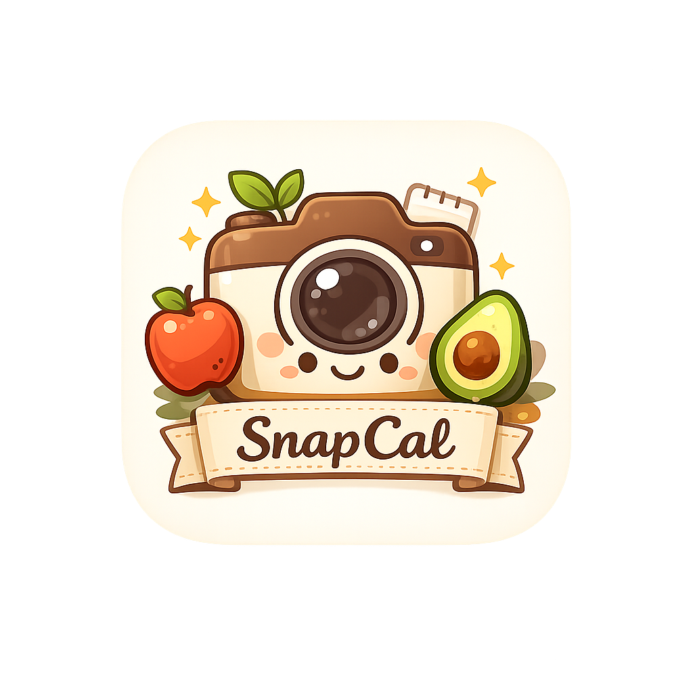
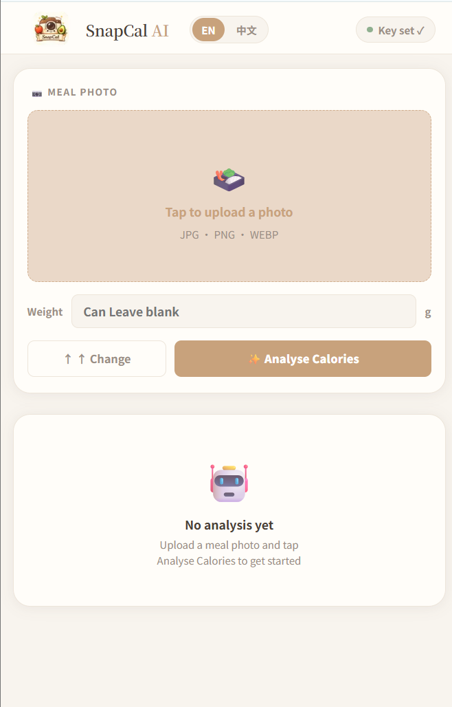
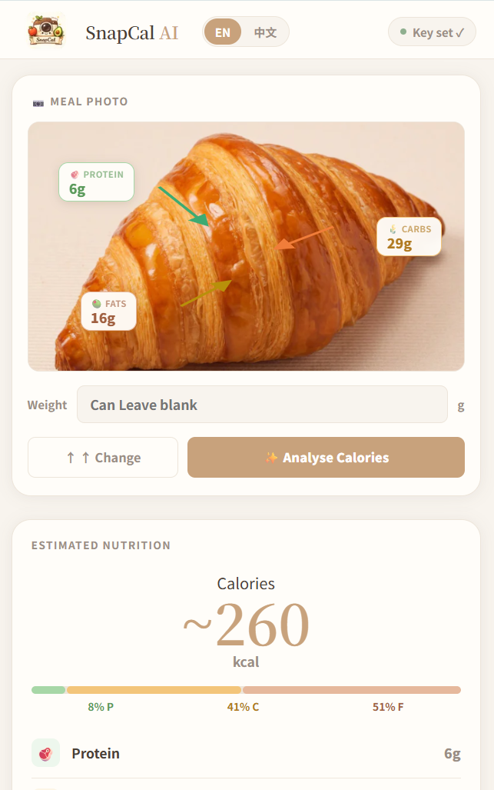
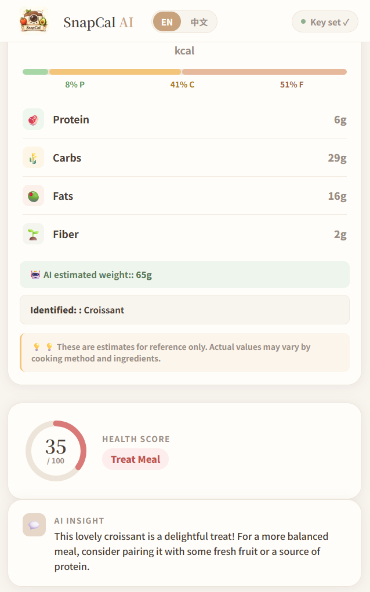
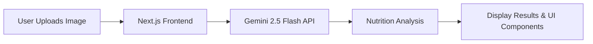

Language: [🇨🇳 中文](README_CN.md) | [🇺🇸 English](README.md)

---

<p align="center">
  
</p>
<h1 align="center">🌿 SnapCal</h1>
 
<p align="center">
  AI-powered food calorie & nutrition analyzer.
</p>
🌐 **Live Demo:** [https://snap-cal-gamma.vercel.app](https://snap-cal-gamma.vercel.app)

---

## ✨ Features

*   **Photo Upload & AR Overlay**: Supports food image uploads and displays core nutrients as interactive bubbles directly on top of the image.
*   **AI Calorie Estimation & Macronutrients**: Accurately estimates total calories and provides a full breakdown of Protein, Carbohydrates, and Fat.
*   **Optional Weight Input**: Allows users to input meal weight to make AI estimations significantly more precise.
*   **Health Score Card**: Visualizes an overall nutritional health score using a circular progress bar for quick diet evaluation.
*   **AI Nutrition Insights**: Delivers warm, friendly, and actionable dietary feedback that avoids robotic or clinical phrasing.
*   **Bring Your Own Key (BYOK)**：Empowers users to use their own Gemini API Key, giving them full control over their AI usage and quotas.

---

## 🖼 UI Screenshot

### Home


### Analysis Result



---

## 🏗 System Architecture



---

## 📂 Project Structure
```
snapcal/
├── app/
│   ├── page.tsx              # Main page, state management, Gemini API call
│   ├── layout.tsx
│   ├── globals.css           # Theme variables + resets only
│   └── icon.png              # Favicon / App icon
├── components/
│   ├── Header.tsx            # Logo, language switch, BYOK button
│   ├── UploadZone.tsx        # Photo upload, camera/gallery picker, nutrition bubbles
│   ├── ResultPanel.tsx       # Calories + macro breakdown
│   ├── HealthScoreCard.tsx   # Circular score + badge
│   ├── AIInsightCard.tsx     # One-line friendly tip
│   ├── KeyModal.tsx          # API key input modal
│   └── *.module.css          # One scoped CSS module per component
├── lib/
│   └── translations.ts       # Single source of truth for EN/ZH strings
└── public/
    └── logo.png
```

---

## 🛠 Tech Stack
- Framework: Next.js 14 (App Router)
- Language: TypeScript
- Styling: CSS Modules — Strictly one stylesheet per component to eliminate global utility dependencies and enforce style isolation.
- AI Engine: Gemini 2.5 Flash

---

## 🚀 Getting Started
### Prerequisites
Before running SnapCal, you will need a Gemini API Key:
1. Go to Google AI Studio and create an API Key.
2. Ensure your key has sufficient quota (upgrading to the Pay-as-you-go billing tier is highly recommended for a stable experience).

---

## 🛠️ Installation & Setup
``` Bash
# 1. Clone the repository
git clone https://github.com/your-username/snapcal.git

# 2. Navigate to the project directory
cd snapcal

# 3. Install dependencies
npm install

# 4. Run the development server
npm run dev
```
Open http://localhost:3000 in your browser to view the application.

---

## 🔒 Privacy & Security
- **Zero Backend Footprint**: No user registration, no database storage, and no tracking analytics.
- **Credential Localization**: Your Gemini API Key is exclusively saved in your browser's `localStorage` and is never transmitted to any third-party backend servers.
- **Ephemeral Image Handling**: Uploaded meal images are securely dispatched to the Google Gemini API and are instantly discarded post-response. SnapCal retains absolutely no image logs.