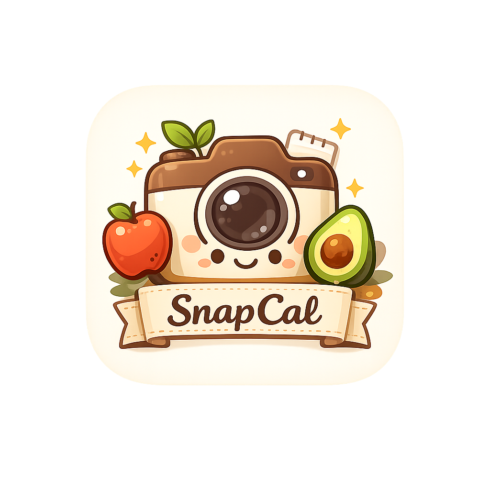
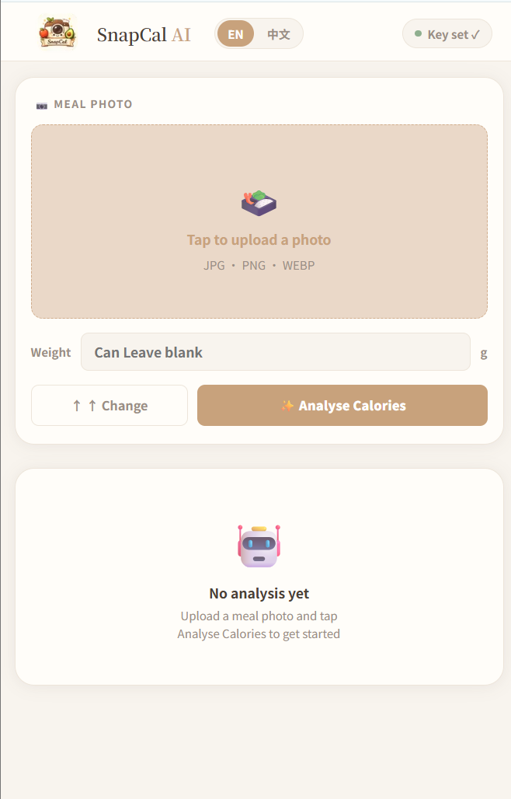
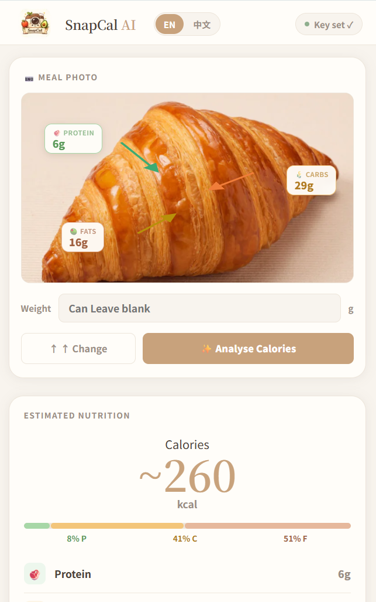
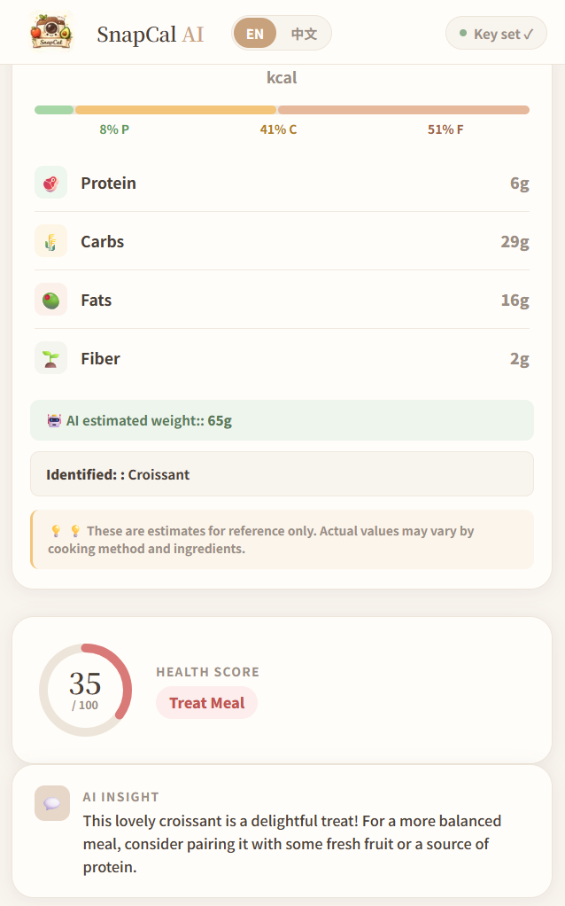
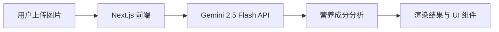

Language: [🇨🇳 中文](README_CN.md) | [🇺🇸 English](README.md)

---

<p align="center">
  
</p>
<h1 align="center">🌿 SnapCal</h1>

<p align="center">
  基于 AI 驱动的食物卡路里与营养成分分析仪。
</p>
🌐 **在线体验:** [https://snap-cal-gamma.vercel.app](https://snap-cal-gamma.vercel.app)

---

## ✨ 核心功能

*   **照片上传与 AR 气泡**：支持上传食物图片，识别后直接在图片上以气泡/图层形式直观呈现核心营养素。
*   **AI 热量估算与宏量营养素分析**：精准估算热量，并全面拆解蛋白质、碳水化合物、脂肪三大宏量营养素。
*   **可选重量输入**：支持可选的食物重量输入，让 AI 的估算结果更加贴近真实。
*   **健康评分卡**：基于单餐营养结构进行圆环可视化综合评分，快速掌握饮食质量。
*   **AI 智能洞察**：拒绝机械化说教，提供充满温度、像朋友一样亲切的智能饮食建议。
*   **自带 Key 模式 (BYOK)**：用户可填入自己的 API Key，完全掌控自己的 AI 算力额度。

---

## 🖼 界面截图

### 首页


### 分析结果



---

## 🏗 系统架构



---

## 📂 项目结构
```
snapcal/
├── app/
│   ├── page.tsx              # 主页面, 状态管理, 调用 Gemini API
│   ├── layout.tsx
│   ├── globals.css           # 仅包含主题变量与重置样式
│   └── icon.png              # 网站图标
├── components/
│   ├── Header.tsx            # Logo、语言切换、BYOK 按钮
│   ├── UploadZone.tsx        # 照片上传、相机/相册选择、营养素气泡
│   ├── ResultPanel.tsx       # 卡路里与宏量营养素拆解
│   ├── HealthScoreCard.tsx   # 圆环评分与徽章
│   ├── AIInsightCard.tsx     # 单行亲切的饮食建议
│   ├── KeyModal.tsx          # API Key 输入弹窗
│   └── *.module.css          # 每个组件独享的局部 CSS Module
├── lib/
│   └── translations.ts       # 中英文翻译文本的唯一事实来源
└── public/
    └── logo.png
```

---

## 🛠 技术栈
- 框架: Next.js 14 (App Router)
- 语言: TypeScript
- 样式: CSS Modules —— 坚持一个组件对应一个样式表，拒绝全局 Utility Classes，保持样式严格隔离。
- AI 引擎: Gemini 2.5 Flash (gemini-2.5-flash) 

---

## 🚀 快速开始
### 前置准备
在使用 SnapCal 之前，你需要准备一个 Gemini API Key：

1. 前往 Google AI Studio 创建你的 API Key。

2. 确保你的 Key 拥有可用配额（建议升级至 Pay-as-you-go 计费层以获得更稳定的调用体验）。

### 本地开发
```bash
# 1. 克隆仓库
git clone https://github.com/your-username/snapcal.git

# 2. 进入项目目录
cd snapcal

# 3. 安装依赖
npm install

# 4. 启动本地开发服务器
npm run dev
```
---

## 🔒 隐私与安全声明
- **零后端存储：**无用户注册系统、无数据库、无行为埋点分析。

- **凭据本地化：**您的 Gemini API Key 仅存储在您浏览器的 localStorage 中，绝不会上传至任何第三方服务器。

- **图片即用即弃：**上传的食物照片会直接安全地发送给 Google Gemini API，在获取到营养分析结果后立即销毁，SnapCal 不会留存任何图片数据。